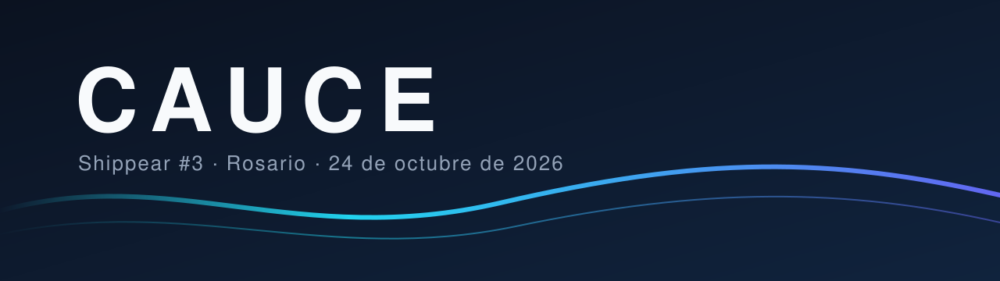

<p align="center">
  
</p>

<p align="center">
  <a href="https://luma.com/n9r4y589"></a>
  
  
</p>

<p align="center">
  <b>Proyecto presentado en Shippear #3 — Tecnoteca, Rosario.</b>
</p>

---

## Índice

- [El problema](#el-problema)
- [Nuestra solución](#nuestra-solución)
- [Track](#track)
- [Demo](#demo)
- [Cómo funciona](#cómo-funciona)
- [Tecnologías](#tecnologías)
- [Cómo correrlo](#cómo-correrlo)
- [Equipo](#equipo)
- [Próximos pasos](#próximos-pasos)

---

## El problema

> _A completar: qué problema real resolvemos, a quién le pasa y por qué hoy está mal resuelto._

## Nuestra solución

> _A completar: qué hace **Cauce** en una o dos frases, y por qué es distinto de lo que ya existe._

## Track

| Track | Elegido |
|---|:---:|
| Vertical AI | ☐ |
| Futuro | ☐ |
| Finanzas | ☐ |
| Social & Sector Público | ☐ |
| Retail | ☐ |

## Demo

- **Aplicación en vivo:** _a completar_
- **Video:** _a completar_
- **Presentación:** [docs/pitch.md](docs/pitch.md)

## Cómo funciona

> _A completar: el recorrido del usuario paso a paso y el lugar que ocupa la inteligencia artificial en cada uno._

## Tecnologías

> _A completar._

## Cómo correrlo

```bash
git clone https://github.com/francoledesma12-bit/cauce.git
cd cauce
```

> _A completar con los pasos para instalar y levantar el proyecto._

## Equipo

| Integrante | Rol | GitHub |
|---|---|---|
| Franco Ledesma | _a completar_ | [@francoledesma12-bit](https://github.com/francoledesma12-bit) |
| Cande Lagar | _a completar_ | [@candepilar](https://github.com/candepilar) |
| Oscar Barrios | _a completar_ | [@oskr2562](https://github.com/oskr2562) |

## Próximos pasos

- [ ] _a completar_

---

<p align="center">
  Hecho en Rosario durante <a href="https://luma.com/n9r4y589">Shippear #3</a> · Distribuido bajo licencia <a href="LICENSE">MIT</a>
</p>
