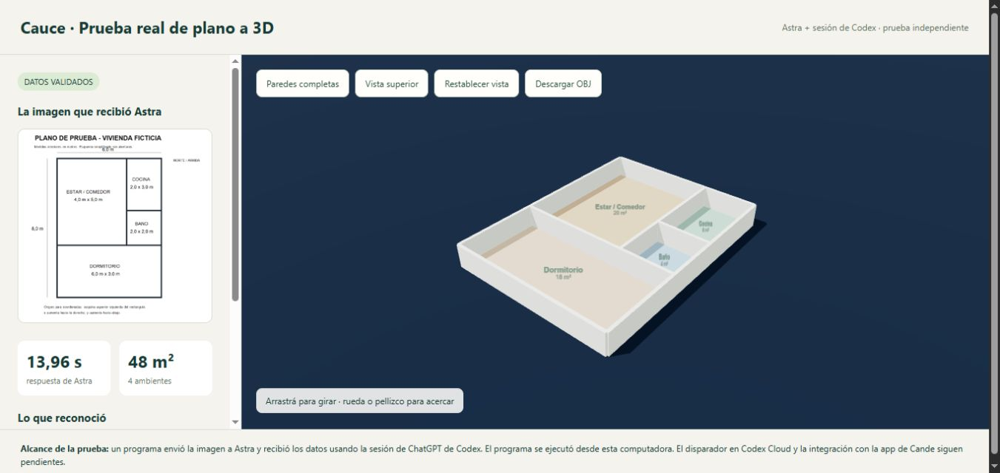

# Contraste del modelado

Pedido de Franco: “el fondo del modelado también debe ser bien contrastado con el modelado, para que se vea bien”.

## Aplicado y verificado en la prueba independiente

- Fondo azul profundo para separar las paredes claras del entorno.
- Pisos con colores más definidos por ambiente.
- Etiquetas más grandes.
- Geometría sin cambios; conserva cuatro ambientes y 48 m².

[Ver prueba publicada](https://andromedaweb.store/cauce-prueba-astra/)

Se revisó en el navegador de escritorio. La revisión en celulares reales sigue pendiente.

## Aplicación principal: pendiente de Cande

Llevar el criterio al visor principal sin sustituir sus mejoras de guía, sol, ciudad y materiales. Revisar el fondo en vista maqueta y recorrido; comprobar que no se pierdan paredes, muebles, etiquetas o controles según el tema y la iluminación.

Definición de listo: se distingue la silueta completa, la profundidad y los ambientes; etiquetas y controles se leen; se prueba en escritorio y en dos celulares. No se afirma cumplimiento de una norma de accesibilidad sin mediciones específicas.

[Coordinación y checklist: issue #1](https://github.com/francoledesma12-bit/cauce/issues/1)

La [plantilla del visor de prueba](../pruebas/astra/visor-prueba.template.html) se archiva como referencia del cambio; contiene marcadores de dependencias/datos y no es un reemplazo de la aplicación.
