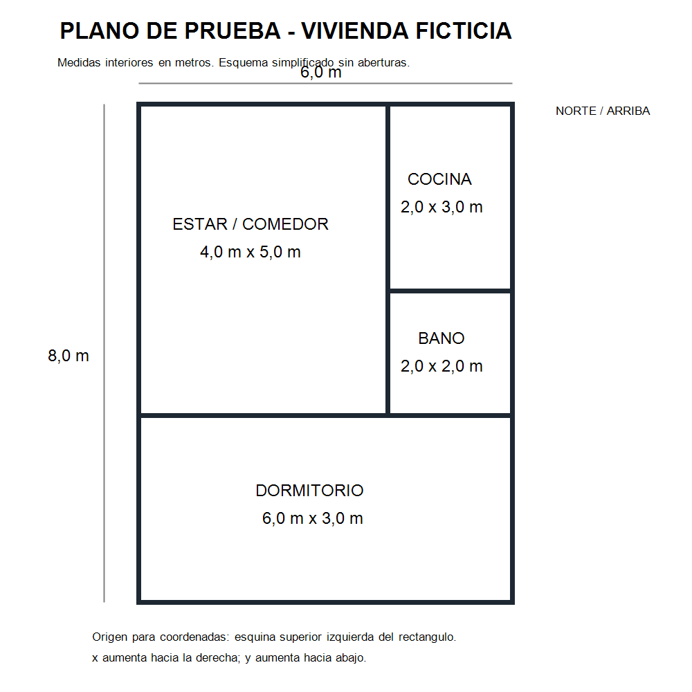

# Evidencia: plano → Astra → maqueta 3D

[Volver al buzón](../../buzon/README.md) · [Abrir resultado interactivo](https://andromedaweb.store/cauce-prueba-astra/)

## Qué se ejecutó

El 24/10/2026, un único comando envió la imagen adjunta a gpt-6-astra mediante Codex CLI con sesión ChatGPT, recibió JSON estructurado, validó la distribución y construyó el OBJ y el visor. El coordinador corrió en la computadora local; la inferencia fue remota. No se configuró una clave de API.

La ejecución completa de las 13:13:57–13:14:11 ART tardó **14,11 segundos**; la consulta a Astra tardó **13,96 segundos**. Una consulta anterior tardó 12,3 s. Son mediciones de este ejemplo, no una garantía de latencia.

## Entrada y salida



- [Prompt usado](prompt.txt)
- [Esquema de respuesta](schema.json)
- [Respuesta original de Astra](resultado-astra.json)
- [Datos del modelo, muros, validación y supuestos](resultado.json)
- [Registro de la ejecución completa](ejecucion-completa.json)
- [Archivo OBJ](modelo.obj)

El esquema de esta prueba usa metros, origen arriba a la izquierda, x hacia la derecha e y hacia abajo. Los ambientes son rectángulos con nombre, tipo, x, y, ancho y largo. Este formato debe adaptarse al visor del equipo si su contrato difiere.

## Validación aplicada

- Exactamente cuatro ambientes: estar/comedor 4 × 5, cocina 2 × 3, baño 2 × 2 y dormitorio 6 × 3 metros.
- Posiciones y dimensiones cotejadas con el plano; suma de superficies: 48 m²; sin superposiciones.
- Sin correcciones manuales de la respuesta o geometría.
- Siete segmentos de muro después de combinar bordes compartidos.
- OBJ descargado desde la URL pública: 11 objetos, 88 vértices y 66 caras.
- Visor revisado en navegador, incluido el control de paredes completas.

Los controles numéricos se diseñaron para este plano de referencia. No son un validador general de cualquier plano.

## Supuestos y límites

Altura de pared de 2,6 m y espesor de 12 cm elegidos para visualizar, porque el plano no los documenta. El plano no dibuja puertas ni ventanas: la respuesta vacía no prueba que una vivienda real carezca de ellas. Esta maqueta sin aberturas valida geometría; no es todavía un recorrido habitable completo.

No se probó aquí generación desde la carga pública, ejecución autónoma en VPS o Codex Cloud, persistencia por propiedad, QR propio, ni calidad con planos complejos o fotos sueltas. El enlace muestra un resultado ya generado; no permite enviar nuevos planos. Usar la sesión local de ChatGPT no demuestra que una integración pública en el VPS tenga la misma autenticación o condiciones de acceso.

## Repetir la interpretación

Se utilizó Codex CLI 0.164.0-alpha.11.1 ya autenticado con ChatGPT. Para repetir únicamente la interpretación desde esta carpeta, con un entorno y acceso al modelo compatibles:

```powershell
Get-Content ./prompt.txt -Raw | codex exec --ignore-user-config --ephemeral --skip-git-repo-check --sandbox read-only --model gpt-6-astra --image ./plano-prueba.png --output-schema ./schema.json --json -
```

Ese comando devuelve eventos y la respuesta; no construye ni despliega automáticamente el visor. La prueba completa agregó un constructor determinista que convierte los rectángulos en suelos, combina bordes compartidos, extruye paredes y exporta OBJ. La integración definitiva debe alimentar el visor existente del equipo, no reemplazarlo por esta página de prueba.

No agregar sesiones, tokens o claves al repositorio para reproducir la prueba.
